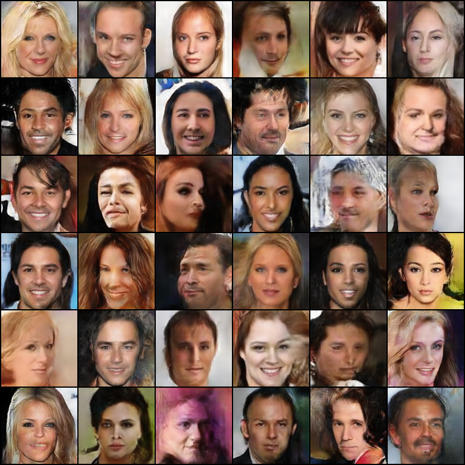
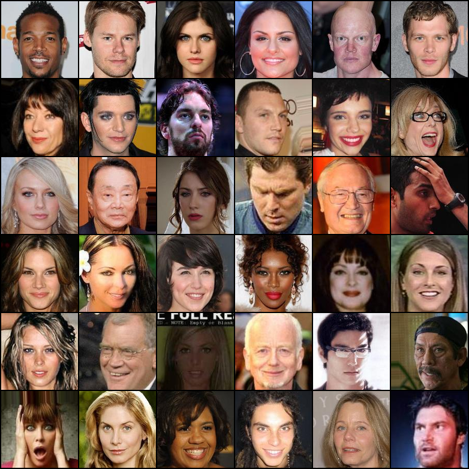
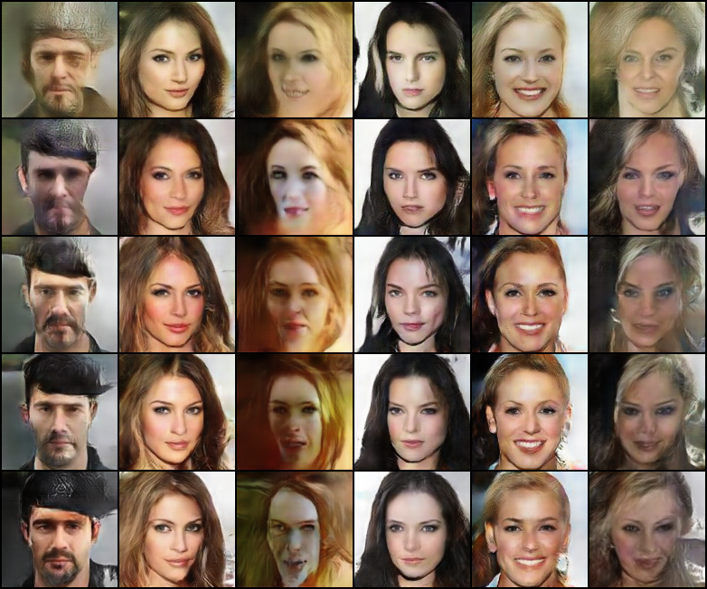
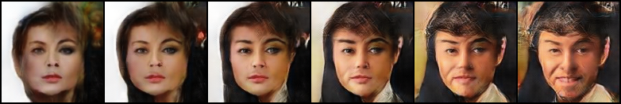
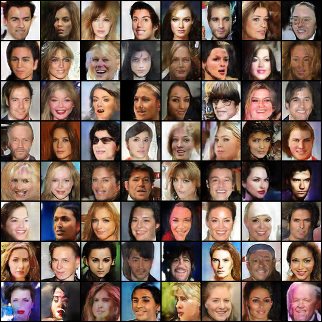
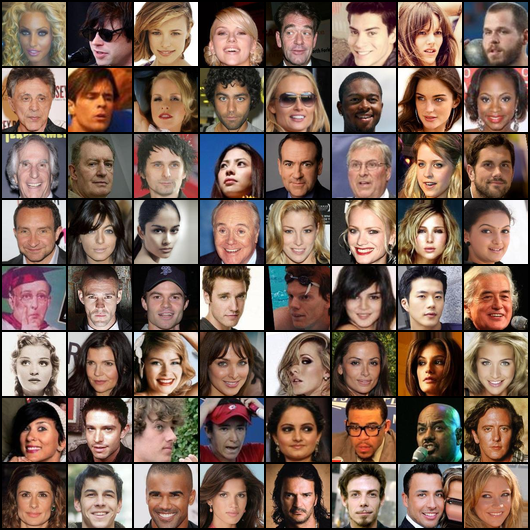
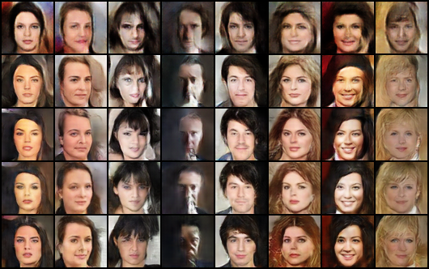

# tcc-dcgans-2019

Geração de faces humanas com **DCGAN** (PyTorch + CUDA) — projeto do TCC (2019), modernizado.
O código original (TensorFlow 1.x, notebook) está preservado na tag [`v2019`](https://github.com/joaoregis/tcc-dcgans-2019/tree/v2019).

| | |
|---|---|
| **Modelo** | DCGAN canônico (Radford et al., 2015), resolução parametrizada (64 e 128 px já treinadas) |
| **Dados** | CelebA (202 599 faces); suporte a FFHQ, CelebA-HQ, UTKFace e LFW |
| **Velocidade** | RTX 4060 (bf16 + `channels_last`): ~6 000 img/s a 64 px (~35 s/época); ~1 400 img/s a 128 px (~2,5 min/época) |
| **Qualidade (FID, menor = melhor)** | 64 px: 26,5 (40 épocas, ~26 min) · 128 px: 31,0 (20 épocas, ~54 min). Não comparáveis entre si |

## Resultados

### 128×128 (CelebA, 20 épocas, FID 31,0)
**Geradas** (esquerda) vs. **reais** (direita):

<p>


</p>

**Evolução** — mesmo `z`, linhas = épocas 2, 4, 8, 12 e 20:



**Interpolação** (seeds 5 e 12):



### 64×64 (CelebA, 40 épocas, FID 26,5)

**Geradas pelo modelo** (esquerda) vs. **imagens reais do CelebA** (direita):

<p>


</p>

**Evolução do treino** — mesmo vetor `z`, linhas = épocas 2, 4, 8, 16 e 40:



**Interpolação** entre dois rostos (seeds 2 e 21, interpolação esférica):


**Aritmética de vetores** (as imagens mostram as seeds usadas e, por último, o resultado). A receita do artigo com 3 amostras por grupo
não funcionou (1ª), mas com 4 amostras e coeficiente 1,5 o resultado ganhou óculos escuros (2ª) — é sensível à escolha das seeds ([faq](docs/faq.md)):


> Os modelos são DCGANs pequenos (3,6 M de parâmetros no gerador) a 64 px: há rostos deformados, e atributos não são controláveis diretamente.
> Qualidade medida por FID (5 000 imagens, menor = melhor). Detalhes e limites em [docs/tuning.md](docs/tuning.md).

## Como usar

### Ambiente (Windows + GPU NVIDIA)
```powershell
uv venv --python 3.11 .venv
uv pip install --python .venv\Scripts\python.exe torch torchvision --index-url https://download.pytorch.org/whl/cu128
uv pip install --python .venv\Scripts\python.exe -r requirements.txt
```
Crie `local.env` com a pasta dos datasets (fora do repo): `DCGAN_DATA_DIR=D:\datasets\faces`.

### Comandos
| Para quê | Comando |
|---|---|
| Testes (14, sem baixar nada) | `.venv\Scripts\python.exe -m pytest -q` |
| Baixar e preparar o CelebA (~1,4 GB; cache 2,5 GB a 64 px) | `.venv\Scripts\python.exe -m dcgan.datasets --sources celeba --resolution 64` |
| Treinar a 64 px (padrão: 20 épocas, ~13 min) | `.venv\Scripts\python.exe -m dcgan.train --sources celeba --resolution 64` |
| Treinar a 128 px (~54 min; cache de 10 GB) | `... -m dcgan.datasets --sources celeba --resolution 128` e `... -m dcgan.train --resolution 128 --batch-size 32 --epochs 20` |
| Retomar um treino | `... -m dcgan.train --resume runs\<data>\ckpt\epoch_010.pt` |
| Gerar imagens | `... -m dcgan.generate runs\<data>\ckpt\epoch_020.pt --n 64 --seed 1` |
| Exportar só o gerador (~14 MB) | `... -m dcgan.generate runs\<data>\ckpt\epoch_020.pt --export gerador.pt` |
| Interpolar / aritmética de vetores | `... -m dcgan.latent gerador.pt interpolate --seeds 2 21` · `arith --expr "mean(24,30,36) - mean(21,26,32) + mean(2,4,17)"` |
| Ajustar hiperparâmetros (FID) | `... -m dcgan.tune --epochs 8 --grid "lr=2e-4,4e-4 beta1=0,0.5"` |
| Curva FID por época | `... -m dcgan.curve runs\<data>` |
| Medir velocidade da GPU | `... -m dcgan.bench --resolution 64` |

Todas as opções do treino: `-m dcgan.train --help`. Cada treino cria `runs/<data>/` com `config.json`, `losses.csv`, `samples/`, `ckpt/`.

## Configuração escolhida
**64 px:** batch 128 · lr 2e-4 (G e D) · Adam β1 0,5 · EMA 0,999 · *label smoothing* 0,1 · bf16 · 20 épocas (40 para o melhor resultado).
**128 px:** igual, mas **batch 32** (lotes menores vencem nessa resolução), 20 épocas.
Escolhidas por medição de FID × tempo ([docs/tuning.md](docs/tuning.md)).

## Estrutura
```
dcgan/        config · datasets · models · train · generate · latent · metrics (FID) · tune · curve · bench
tests/        pytest
docs/         documentação viva (comece por docs/README.md)
docs/exemplos imagens usadas neste README
```

## Documentação
Comece por [docs/como-funciona.md](docs/como-funciona.md) (explicação didática) e [docs/faq.md](docs/faq.md).
Mais: [migração 2019 → hoje](docs/migracao.md) · [modelo](docs/modelo.md) · [dados](docs/dados.md) · [treino](docs/treino.md) · [usar o modelo](docs/usar-modelo.md) · [desempenho](docs/desempenho.md) · [ajuste de hiperparâmetros](docs/tuning.md) · [log](docs/log.md).

## Estado e próximos passos
- [x] Reescrita em PyTorch + CUDA, testes, cache de dados, EMA, FID, ajuste a 64 px
- [x] Modelo de 64 px treinado (FID 26,5) e inferência/interpolação/aritmética
- [x] 128 px: ajuste e treino (FID 31,0)
- [ ] Mais bases (FFHQ, CelebA-HQ, UTKFace, LFW): download manual ainda não feito
- [ ] 256 px (provavelmente exige arquitetura/treino mais elaborados)
